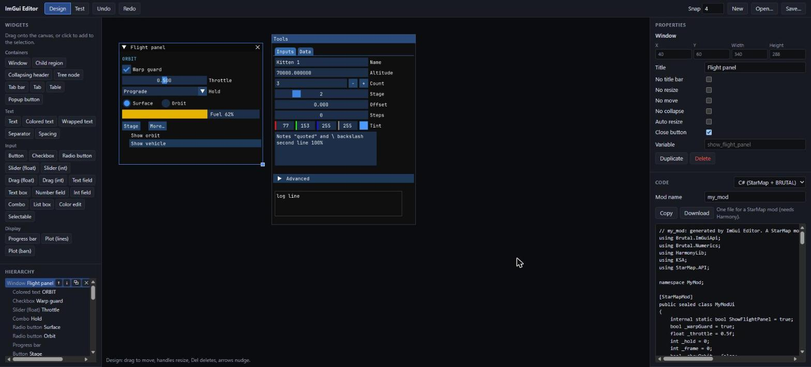

# ImGui Editor

**Open it: https://safeshows.github.io/imgui-editor/**

Design Dear ImGui windows in the browser and get the code for them, mainly for **Kitten Space Agency** mods:



| Target | What you get |
| --- | --- |
| C# (StarMap + BRUTAL) | A `[StarMapMod]` class drawing with `Brutal.ImGuiApi.ImGui` in `[StarMapAfterGui]`, plus a Harmony postfix on `KSA.Program.DrawProgramMenusHook` that adds show/hide entries to the Mods menu. |
| Rust (Oxidizer) | A `Ui` struct (state + `draw()` + `menu()`) using `oxidizer_api::imgui`. |
| Rhai (Oxidizer) | `init()`, `menu()` and `gui(dt)` to merge into a mod's `main.rhai`. |
| C++ | Plain Dear ImGui with static state. |
| C | The same through cimgui. |

The preview is real Dear ImGui (1.92, via [jsimgui](https://github.com/mori2003/jsimgui)) with KSA's font, so what you
see is what ImGui lays out. Output is layout only: buttons get an empty `/* clicked */` block, and each widget that
keeps a value gets a variable (named from its label; override it in Properties).

## Using it

- **Design** mode: drag widgets from the palette onto a window (or click one to add it to the selection), drag to
  move, use the handles to resize, Del to delete, arrows to nudge (Shift: 10 px), Ctrl+D to duplicate, Ctrl+Z/Y.
- Widgets directly in a window or child region are placed absolutely (`SetCursorPos`). Inside headers, tree nodes,
  tabs, tables and popups they flow in order: reorder them in the hierarchy (arrows, or drag a row onto another).
- **Test** mode: the widgets work as they would in the game.
- Designs autosave in the browser; **Save…** / **Open…** read and write `.imgui.json` files.

## Preview looks

With a KSA target (C#, Rust, Rhai) the preview uses the game's look: its JetBrains Mono font and the ImGui style in
[src/ksa-style.json](src/ksa-style.json). With C or C++ it is stock Dear ImGui (ProggyClean, the default dark style),
and the generated C/C++ sets no style, so it looks the same in your app.

`ksa-style.json` is captured from the game itself by [tools/ImGuiStyleDump](tools/ImGuiStyleDump), a StarMap mod that
writes every ImGui style value, color and the font size to `Documents/My Games/Kitten Space Agency/imgui_style.json`
on the first frame:

1. `dotnet build -c Release` in `tools/ImGuiStyleDump`.
2. Copy `bin/Release/net10.0/ImGuiStyleDump.dll` and `mod.toml` to `mods/ImGuiStyleDump/`, add
   `[[mods]] id = "ImGuiStyleDump" enabled = true` to `manifest.toml`, and start the game through StarMap.
3. Replace `src/ksa-style.json` with the `imgui_style.json` it wrote, then disable the mod again.

## Oxidizer versions

Tree nodes, tables, popups, tooltips, plots, radio buttons, selectables, list boxes, int sliders, drags, wrapped text,
spacing, window flags and sized child regions need `oxidizer_api` 0.9 and the matching Oxidizer (branch
`feat/imgui-widgets`). The generated Rust and Rhai say in their first line which version they need.

## Development

```sh
npm install
npm run dev       # http://localhost:5173
npm test          # code generator checks
npm run build     # static site in dist/
npm run preview   # serve dist/ at http://localhost:4173
```

`OUT=some/dir npm test` also writes the sample design's code for every target, which is how it's checked to compile:
Rust against `oxidizer_api`, C# against the game's `KSA.dll` and `Brutal.*.dll`, C++ and C with clang against
Dear ImGui and cimgui headers, and Rhai with the `rhai` parser.

`.github/workflows/pages.yml` deploys `dist/` to GitHub Pages on pushes to `main` (enable Pages with source "GitHub
Actions" first).
